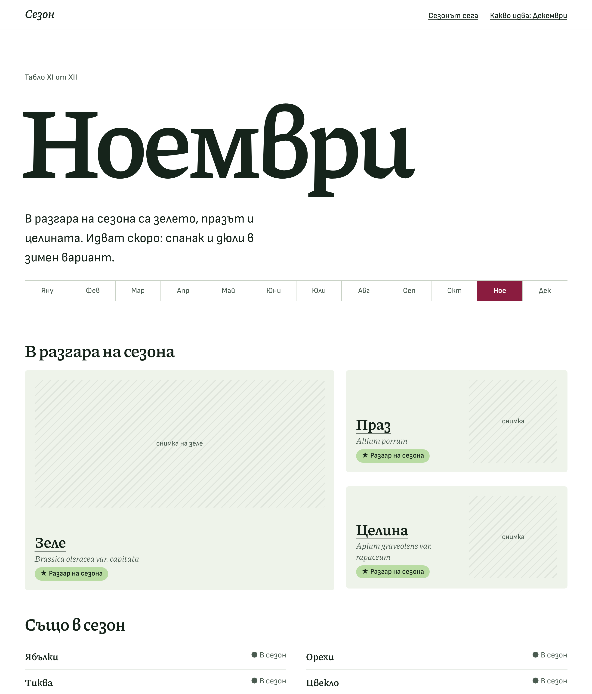
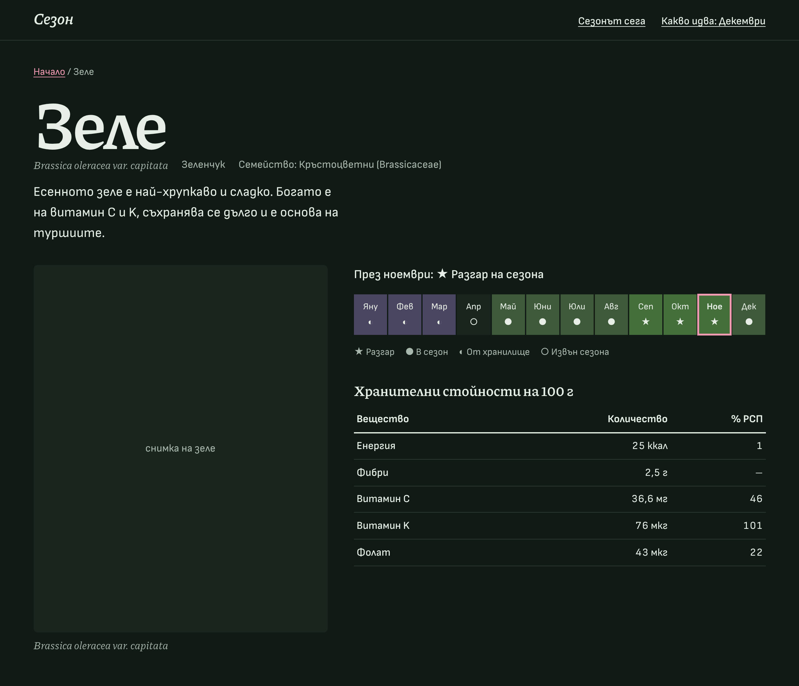

# ADR-0004: Visual identity, the botanical atlas

- **Status:** Proposed
- **Date:** 2026-11-10
- **Issue:** #35 (part of the redesign #28; implemented by #36 tokens and fonts, #37 restyle)

## Context

The Phase 1 design is a clean but neutral token set with a system font stack. It is accessible
and scores 100 in Lighthouse, but nothing about it says „Bulgarian seasonal produce“. The owner
asked for a distinctive identity, following `.claude/skills/frontend-design`, and chose the
direction in four answers:

| Question         | Owner's choice                                                       |
| ---------------- | -------------------------------------------------------------------- |
| Direction        | **Botanical atlas**: herbarium plates, Latin names, scientific care. |
| Typefaces        | **Self-hosted web fonts** with Cyrillic.                             |
| Imagery          | **Photographs** of the produce.                                      |
| Home page opener | **The month as typography**: the month name is the hero.             |

**Subject:** what grows in Bulgaria this month, with sourced nutrition facts.
**Audience:** Bulgarian shoppers and cooks on their phones, plus readers who check health
claims. **Primary job:** answer „какво е в сезон сега?“ in one glance, then earn trust with
precise, sourced detail. The atlas direction serves both: the plate format shows one specimen
at a time with its name, and the scientific register matches the YMYL content.

Constraints that the identity must keep: WCAG 2.2 AA in light and dark mode, zero axe
violations, Lighthouse 100 in all four categories, readable without CSS (spec 009), no client
JavaScript, and tokens tested for contrast (spec 003).

## Decision

Adopt the **botanical atlas** identity below. Each page is treated as a plate in an atlas:
a large serif name, its Latin binomial in italic, a photograph, and precise tables. The single
bold element is the **month name set as a giant display word** on the home page. Everything else
stays quiet.

### Colour (light and dark)

Five named colours, plus three season tints that carry the season level next to text and an
icon (never colour alone).

| Name                    | Role (token)                 | Light                | Dark                 |
| ----------------------- | ---------------------------- | -------------------- | -------------------- |
| Хербарий (herbarium)    | page `background`            | `#ffffff`            | `#111a14`            |
| Табло (plate)           | `surface` for plates, panels | `#eef3ea`            | `#1a251e`            |
| Мастило (ink)           | `text`                       | `#16241b`            | `#e7eee6`            |
| Графит (graphite)       | `textMuted`                  | `#4a5b50`            | `#a8b8ac`            |
| Кармин (carmine)        | `accent`: links, „now“       | `#8a1c3f`            | `#f29ab2`            |
| Season: peak            | `peak`                       | `#b9dca3`            | `#446f3b`            |
| Season: available       | `available`                  | `#dfe9c8`            | `#3f5a3a`            |
| Season: from storage    | `storage`                    | `#dcd6e6`            | `#4a4560`            |
| Hairline rules, borders | `rule` (new), `border`       | `#c9d2c6`, `#7c8c80` | `#2c3a31`, `#6f8174` |
| Focus ring              | `focus`                      | `#1f5fa8`            | `#8cc2ff`            |

Text on accent is `#ffffff` (light) and `#2a0b16` (dark); text on season tints is ink in light
mode and `#f1f5ef` in dark mode.

Carmine is the colour of beetroot, cherries and rosehip, and of the hand-coloured accents on
old botanical plates. It marks one thing only: **where you are now** (the current month in the
year ribbon and in a produce calendar) and links. Green stays in the season tints, where it
means „fresh“, instead of tinting the whole site.

**Contrast** (WCAG 2.x ratio, computed with `src/design/contrast.ts`; minimum 4.5 for text,
3 for focus and borders):

| Pair                    | Light | Dark  |
| ----------------------- | ----- | ----- |
| text on background      | 16.13 | 15.04 |
| text on surface         | 14.32 | 13.39 |
| textMuted on background | 7.23  | 8.56  |
| textMuted on surface    | 6.42  | 7.62  |
| accent on background    | 9.06  | 8.50  |
| accent on surface       | 8.04  | 7.56  |
| accentText on accent    | 9.06  | 8.67  |
| onBadge on peak         | 10.62 | 5.32  |
| onBadge on available    | 12.77 | 6.96  |
| onBadge on storage      | 11.37 | 8.24  |
| focus on background     | 6.44  | 9.54  |
| focus on surface        | 5.72  | 8.50  |
| border on background    | 3.55  | 4.29  |

Every pair passes. #36 moves these values into `src/design/tokens.ts`, where the existing unit
tests keep enforcing them.

### Typography

Two families, clearly distinct, both open source (SIL OFL), self-hosted as WOFF2 subsets with
Cyrillic and Latin only, from Fontsource packages:

| Family                            | Role                                                                              |
| --------------------------------- | --------------------------------------------------------------------------------- |
| **Piazzolla** (variable, `wght`)  | Display and headings, the month word, produce names, Latin binomials in _italic_. |
| **Sofia Sans** (variable, `wght`) | Body text, navigation, labels, tables (tabular figures).                          |

Why these two:

- **Bulgarian Cyrillic.** Bulgarian readers expect the Bulgarian letterforms (д, л, ж and others
  drawn like Latin lowercase, not the Russian forms). Piazzolla ships them through the `locl`
  feature for `lang="bg"`, which the site already sets. Sofia Sans is designed by a Bulgarian
  type designer and uses the Bulgarian forms by default. Of the twelve candidates compared,
  Alegreya, EB Garamond and Literata lack Bulgarian forms, and Fraunces has no Cyrillic at all
  (see `assets/0004/font-comparison.png`).
- **Atlas register.** Piazzolla is a sturdy text serif with an optical-size axis: at display
  sizes it becomes sharp and engraved, like plate titles; its italic is natural for Latin
  names, which botanical convention already sets in italic (so this is not a decorative
  accent).
- **Weight.** About 20–25 KB per Cyrillic subset. The plan is at most four files on a page
  (Piazzolla roman and italic, Sofia Sans roman; Latin subsets load only when needed via
  `unicode-range`), with `font-display: swap`, the upright files preloaded, and metric-adjusted
  fallbacks (`size-adjust`) to keep CLS at 0. #36 verifies Lighthouse stays at 100.

**Type scale** (following Bringhurst's guidance on a small number of related sizes): body
1.0625 rem / 1.55 Sofia Sans; lede 1.25–1.6 rem; h3 1.5–2.1 rem; h2 1.6–2.2 rem Piazzolla 600;
produce title 3.5–6.5 rem; the month word 4.5–13.5 rem (`clamp`, tracking −0.035 em,
leading 0.82). Body lines stay under 80 characters (`max-width` 34–40 ch for ledes).

### Imagery

Photographs of each produce, framed as **plates**: a sage `surface` panel with the photo inside,
and the Latin binomial as the caption in Piazzolla italic. Photos use `astro:assets`
(AVIF/WebP, explicit `width`/`height`, lazy below the fold, the home hero photo eager). Each
photo records its source and licence in the produce data (for example Unsplash licence or the
owner's own photos) and has a Bulgarian `alt`. Sourcing photos is content work (#38–#41); the
redesign ships the plate frame with a graceful empty state.

### Layout

Left-aligned throughout (ragged right); only numeric table columns are right-aligned.
Content width 74 rem; reading width about 40 ch.

Home page:

```
┌────────────────────────────────────────────────────────────┐
│ Сезон                          Сезонът сега  Какво идва: … │  header, hairline below
├────────────────────────────────────────────────────────────┤
│ Табло XI от XII                                            │  plate number (months are a real sequence)
│ ███  Н О Е М В Р И  ███                                    │  the month word, 4.5–13.5 rem
│ В разгара на сезона са зелето, празът и целината. …        │  one-sentence lede
│ Яну│Фев│Мар│Апр│Май│Юни│Юли│Авг│Сеп│Окт│[Ное]│Дек         │  year ribbon, current month carmine
├────────────────────────────────────────────────────────────┤
│ В разгара на сезона                                        │
│ ┌──────────────────────┐ ┌─────────────────────┐           │
│ │      photo           │ │ Праз        [photo] │           │  first specimen is the large plate,
│ │                      │ │ Allium porrum       │           │  the rest are smaller plates:
│ │ Зеле                 │ └─────────────────────┘           │  sizes encode the order, not
│ │ Brassica oleracea …  │ ┌─────────────────────┐           │  identical cards
│ │ ★ Разгар на сезона   │ │ Целина      [photo] │           │
│ └──────────────────────┘ └─────────────────────┘           │
│ Също в сезон                                               │
│ Ябълки ......... ● В сезон   Орехи .......... ● В сезон    │  quiet two-column index with hairlines
└────────────────────────────────────────────────────────────┘
```

Produce page:

```
┌────────────────────────────────────────────────────────────┐
│ Начало / Зеле                                              │
│ Зеле                                                        │  title 3.5–6.5 rem
│ Brassica oleracea var. capitata   Зеленчук   Семейство: …  │  facts list (one wrapping row)
│ Есенното зеле е най-хрупкаво и сладко. …                   │
│ ┌──────────────┐  През ноември: ★ Разгар на сезона         │
│ │              │  Я Ф М А М Ю Ю А С О [Н] Д                 │  12-month strip: tint + glyph + text
│ │    photo     │  ★ Разгар ● В сезон ◐ От хранилище ○ Извън │
│ │              │  Хранителни стойности на 100 г             │
│ └──────────────┘  ─────────────────────────────── (2 px)    │  scientific table, hairline rows,
│ Brassica oleracea  Енергия          25 ккал        1        │  tabular figures
│ var. capitata      Витамин C        36,6 мг       46        │
└────────────────────────────────────────────────────────────┘
```

On phones every grid collapses to one column in source order (spec 009: CSS never reorders);
the year ribbon shows three-letter abbreviations in two rows of six (spec 013).

### Principles

1. **One bold gesture.** The month word is the only loud element. Everything else is ink on
   paper with generous space.
2. **Plates, not cards.** Specimens differ in size by importance; there is no grid of identical
   rounded cards, no shadows and no gradient washes.
3. **Carmine means „now“.** One accent colour with one meaning: the current month, and links.
4. **Science you can check.** Latin names in italic, tabular figures, hairline tables, sources
   next to every claim; this is the atlas register and it supports the YMYL content.
5. **Bulgarian letterforms.** Never ship a typeface that renders Russian Cyrillic forms.
6. **Structure first.** Every visual device encodes information (plate number = month sequence,
   tint + glyph + text = season level, size = importance). The page reads correctly without CSS.

### Mock-ups

Built from real content with the proposed fonts and colours (`assets/0004/`):

- `m-home-light.png`, `m-home-dark.png`: home page, desktop.
- `m-home-light-mobile.png`: home page, 390 px.
- `m-produce-light.png`, `m-produce-dark.png`, `m-produce-dark-mobile.png`: produce page.
- `font-comparison.png`: the twelve Cyrillic candidates.




### Review against generic defaults

Checked against the defaults listed in the frontend-design skill:

| Generic default                                          | This plan                                                                                                                                                                 |
| -------------------------------------------------------- | ------------------------------------------------------------------------------------------------------------------------------------------------------------------------- |
| Warm cream background, serif display, terracotta accent  | First draft had a pale sage page (`#f3f5ef`) with a serif: too close. **Changed** to a white herbarium sheet with sage plates, and carmine instead of a warm clay accent. |
| Near-black background with one acid accent               | Dark mode is a deep green night herbarium with the same carmine role, not a neon accent.                                                                                  |
| Broadsheet hairlines, zero radius everywhere             | Hairlines only where the content is tabular (nutrition, indexes); plates keep a small radius.                                                                             |
| Identical rounded cards with soft shadows and gradients  | Plates of different sizes, no shadows, no gradients.                                                                                                                      |
| ALL-CAPS eyebrows, middot meta strings, mono labels, „→“ | None. The only label above the month („Табло XI от XII“) encodes the month's position in a real sequence.                                                                 |
| Single word accented in a headline                       | None; Latin names are italic because botanical convention requires it.                                                                                                    |

## Consequences

- **Positive:** a recognisable identity tied to the subject; Bulgarian letterforms; the season
  levels stay text + glyph + tint; the plate structure gives photos a consistent frame.
- **Negative:** web fonts add about 115 KB on first visit (Cyrillic and Latin upright subsets of
  both families, all preloaded; the Latin italic adds about 32 KB on pages with Latin names); #36 must prove
  Lighthouse 100 and CLS 0 with metric-adjusted fallbacks. Photos need sourcing and licences.
- **Neutral:** the token names in `src/design/tokens.ts` stay; values change and one token
  (`rule`) is added. The storage glyph becomes `◐`. Season glyphs are outside the font subsets and render in the
  system font.
- **Next:** #36 implements the tokens, fonts and fallbacks; #37 restyles the layout and
  components. Both are gated by spec 009 (readable without CSS) and the existing axe and
  Lighthouse checks.
