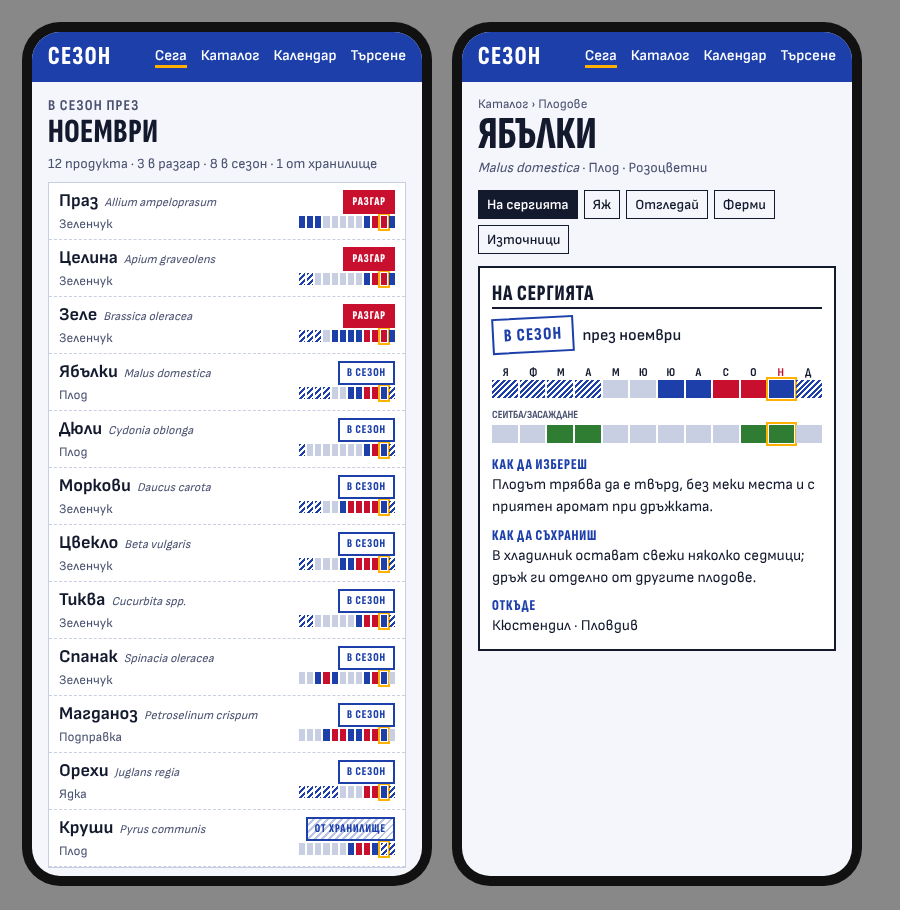
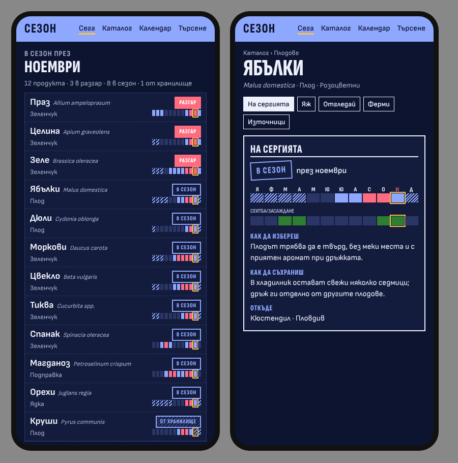
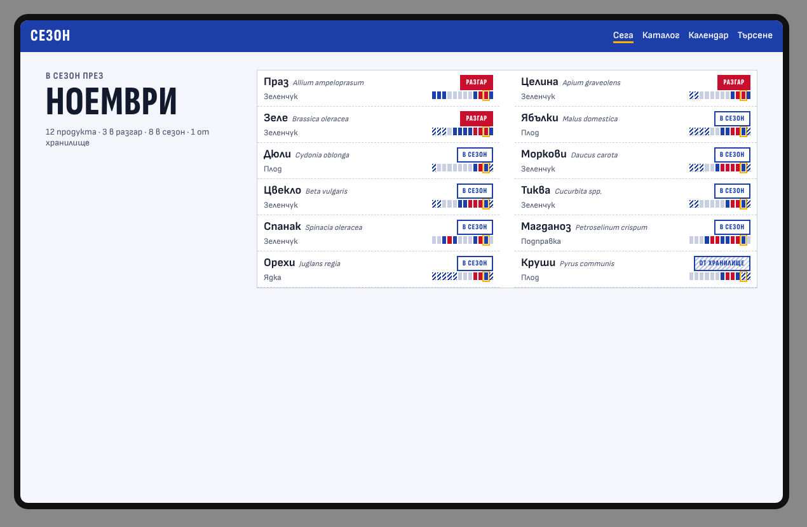
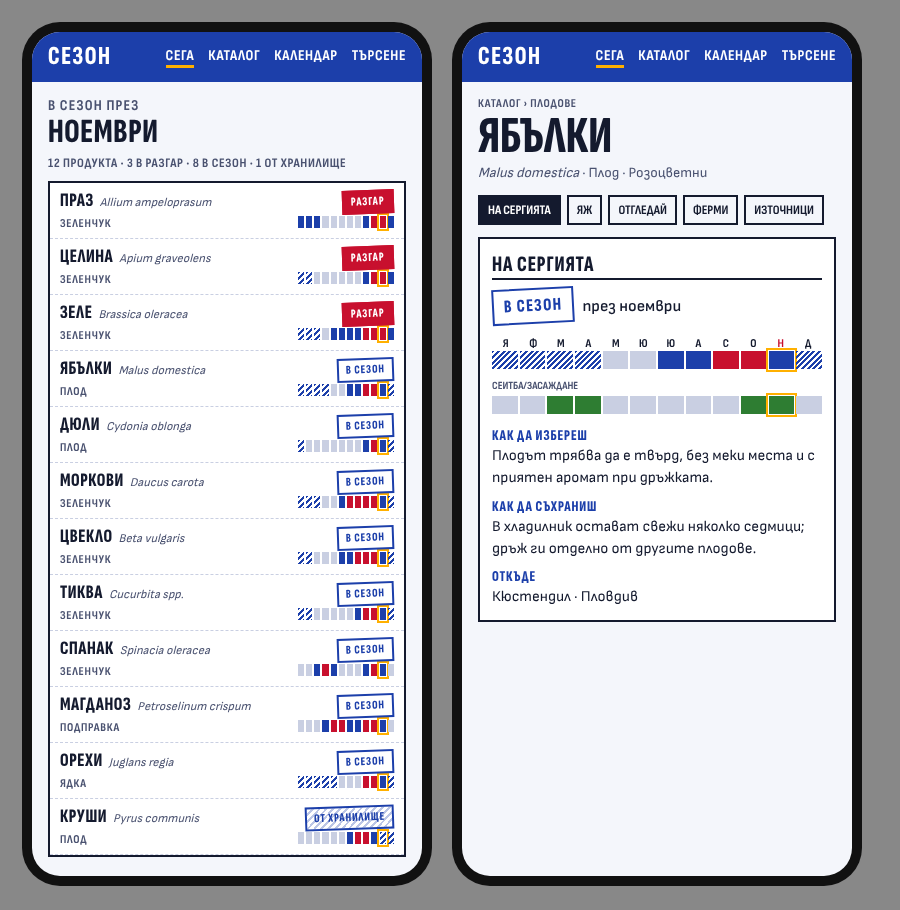
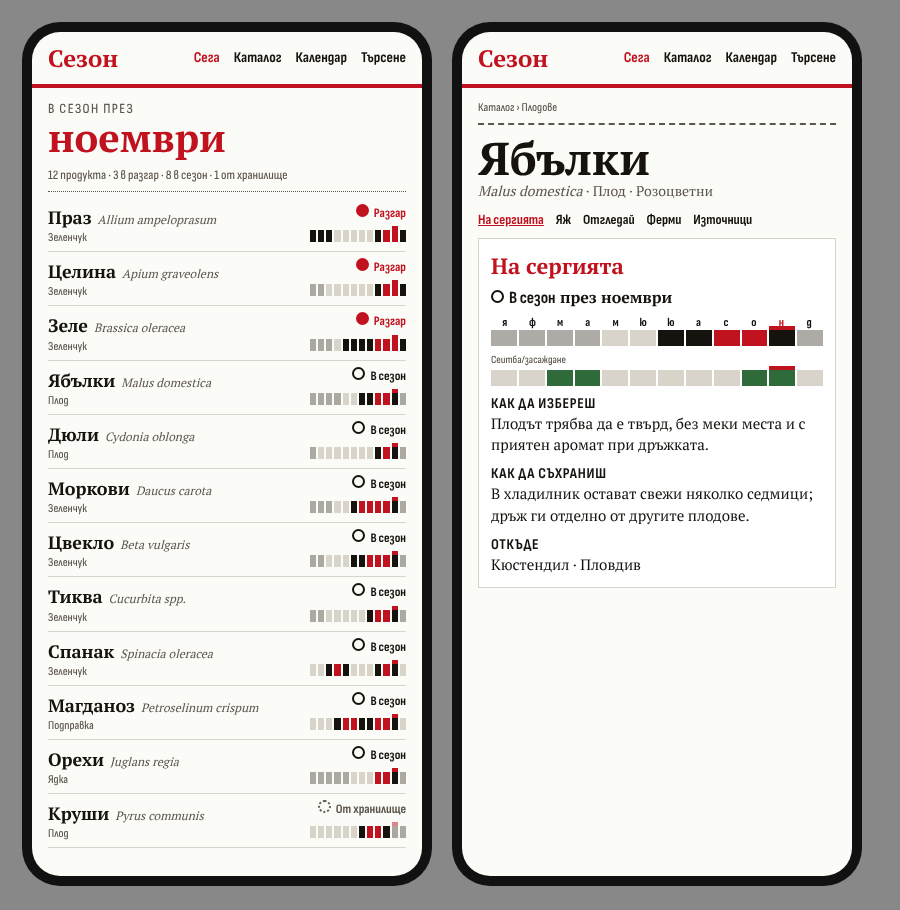
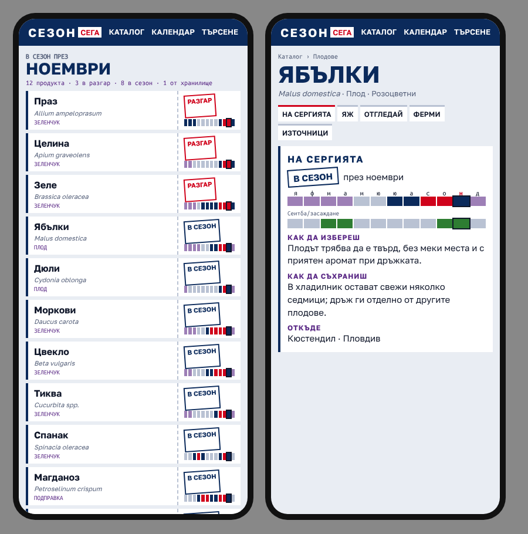
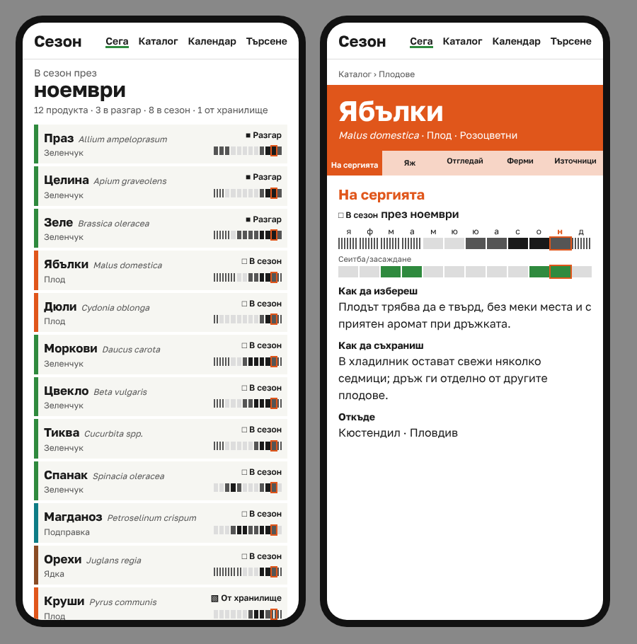

# Visual directions (issue #81)

Step 3 of the redesign epic #78, built on the brief in `docs/design/brief.md`. Four directions
were sketched as HTML on the real November data (home and the apple page, mobile), and the owner
chose one on 2026-11-11. The decision is recorded in
[ADR-0006](../../ADR/0006-visual-direction-stamp-of-origin.md).

The sketches are compositions, not finished designs: they use web fonts from Google Fonts and
are not built to the performance budget.

## How the directions were made

The world grammar comes from the impeccable skill's `concept-seed` (scope `direction`, mode
`operate`). Seven candidate worlds were taken from the audience's own surroundings, ordered
by resonance:

1. a tear-off wall calendar;
2. seed packets with the sowing calendar on the back;
3. hand-written cardboard signs at the market;
4. stencilled fruit crates and their stamps of origin;
5. labels on jars of winter preserves;
6. thematic maps of the 28 provinces in agricultural statistics;
7. a railway timetable board.

The roll assigned candidate 4. It also dealt six challenger worlds from the catalogue, and each
was fused with the product and weighed on two axes, audience recognition and product clarity.

| Direction              | Source                       | Verdict                                                          |
| ---------------------- | ---------------------------- | ---------------------------------------------------------------- |
| **A. Stamp of origin** | Candidate 4 (assigned)       | **Chosen, calmer variant**                                       |
| B. Tear-off calendar   | Candidate 1 (own top pick)   | Runner-up: familiar and calm, but close to the current site      |
| C. Coupon              | Challenger: ticket wallet    | Competitive on clarity; denser, fewer items per screen           |
| D. Section tab boards  | Challenger: manual tab board | Competitive on clarity; clean, but weaker identity               |
| Orienteering map       | Challenger                   | Declined. Kept: one accent reserved for „now“                    |
| Doujin event catalogue | Challenger                   | Declined. Kept: a dense whole-cell list, all items on screen one |
| Emission-line rail     | Challenger                   | Declined. Kept: season level carried by form, not hue            |
| Dark developer console | Challenger                   | Declined. Kept: dark mode designed as its own scale              |

## A. Stamp of origin (chosen)

- **World:** stencilled crates and the rubber stamps of origin and grade on them.
- **Palette:** stamp ultramarine owns the shell, near-white label paper, stencil-black ink,
  stamp red for „Разгар“ only, and one marker yellow reserved for the current month.
- **Type:** Sofia Sans Extra Condensed in capitals for headings, the logo and stamps; Sofia Sans
  for everything else (the family is already self-hosted).
- **Signature move:** the season stamp. A solid stamp means „Разгар“, an outlined stamp
  „В сезон“, a hatched stamp „От хранилище“, so the level reads by form before colour. The
  12-month strip uses the same three forms.
- **Calmer variant (owner choice):** capitals only in headings and stamps, upright stamps in long
  lists (only the large stamp on the produce page is tilted), sentence-case navigation and lists.

Original A for comparison: 

## Runners-up

